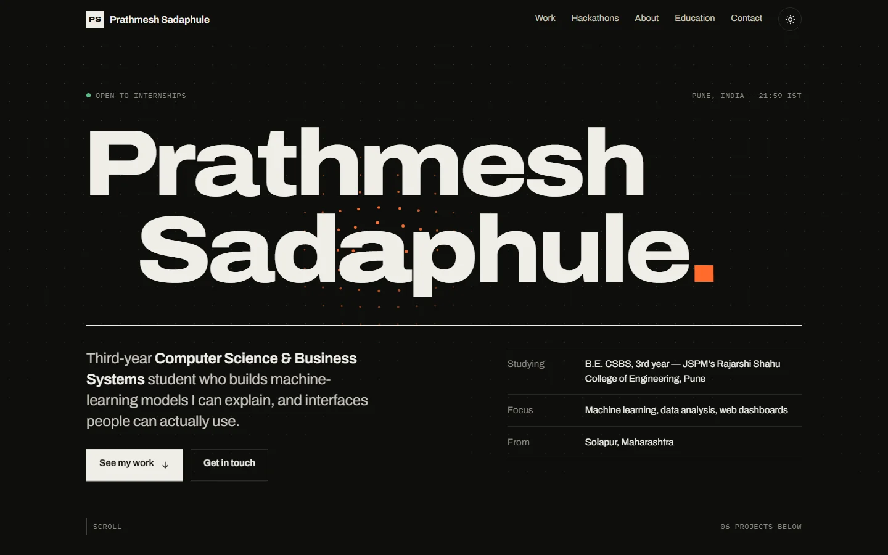
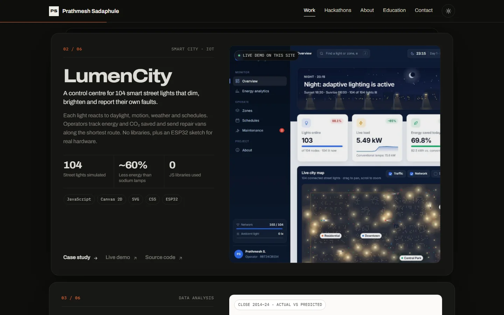
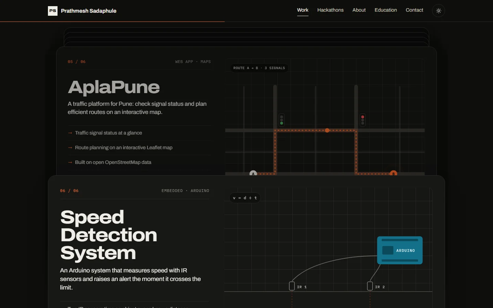
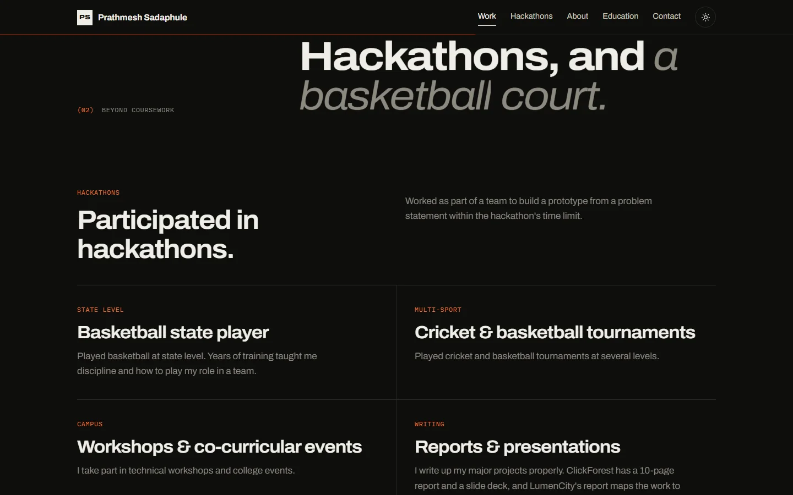
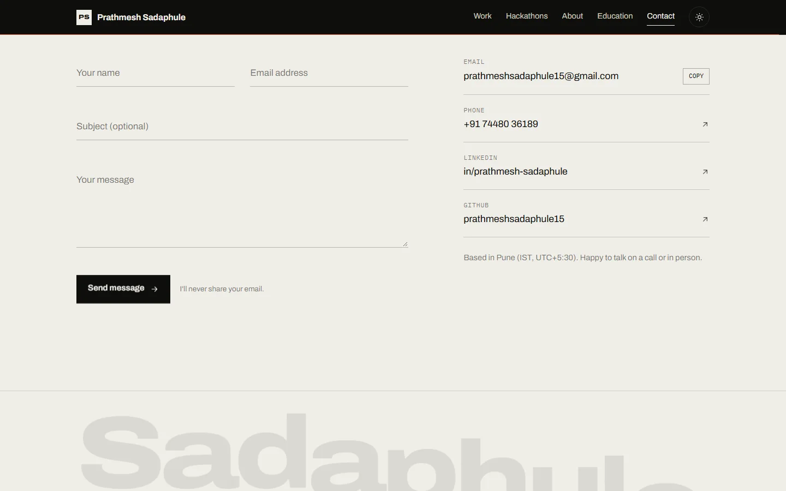
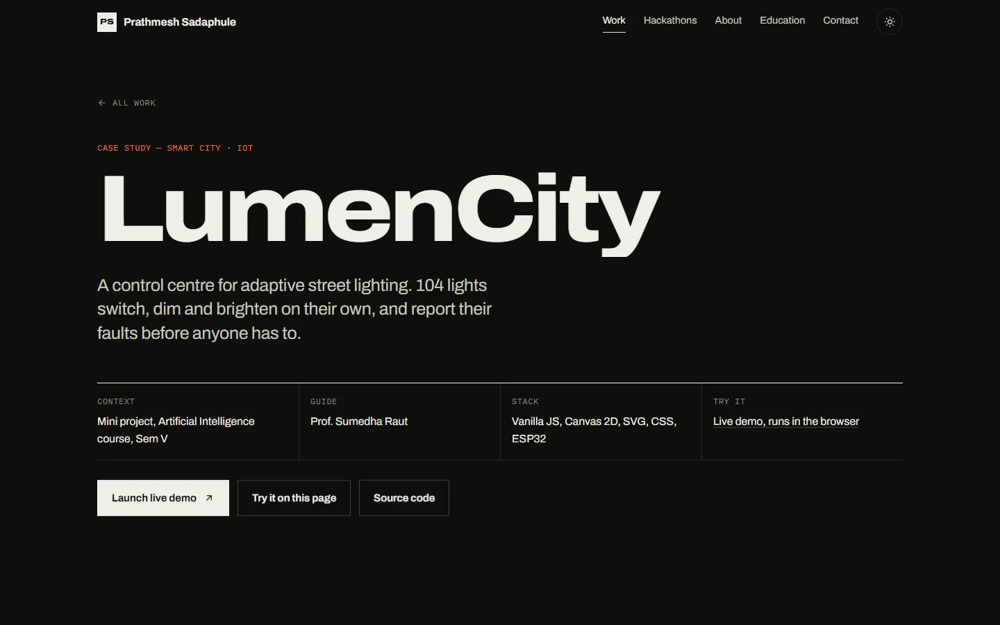
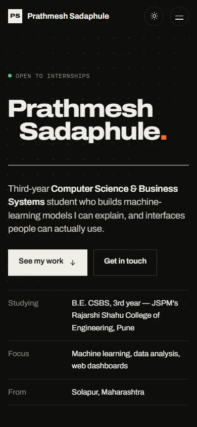

# Prathmesh Sadaphule: Portfolio

My personal portfolio. I'm a third-year Computer Science & Business Systems student at JSPM's Rajarshi Shahu College of Engineering, Pune, and I work on machine learning, data analysis, web dashboards and hardware projects.

**Live site:** https://prathmeshsadaphule15.github.io/Portfolio/



## Projects featured

| # | Project | What it is | Links |
|---|---|---|---|
| 01 | **ClickForest** | Ad-click prediction with a Random Forest built from scratch. 96.4% test accuracy, ROC-AUC 0.991 | [Case study](projects/clickforest.html) · [Code](https://github.com/prathmeshsadaphule15/Random-Forest) |
| 02 | **LumenCity** | Control centre for 104 adaptive smart street lights, about 60% less energy than conventional lamps | [Case study](projects/lumencity.html) · [Live demo](demos/lumencity/index.html) · [Code](https://github.com/prathmeshsadaphule15/SmartCity) |
| 03 | **SENSEX, ten years in** | 10 years of BSE SENSEX data: EDA, PCA, regression, and why R² 0.999 is misleading | [Case study](projects/sensex.html) · [Code](https://github.com/prathmeshsadaphule15/sensexanalysis) |
| 04 | **Rahul Downtown Society** | Role-based society management for residents, guards and admin (Firebase) | |
| 05 | **AplaPune** | Traffic signal status and route planning on a Leaflet map | |
| 06 | **Speed Detection System** | Arduino and IR sensors that measure speed and alert above the limit | |

## Screenshots

| | |
|:---:|:---:|
|  |  |
| **Projects:** real screenshots and key numbers | **Stacked cards:** each card pins as the next slides over |
|  |  |
| **Beyond coursework:** hackathons and sports | **Contact:** the form sends straight to my inbox |
|  |  |
| **Case study pages** for the major projects | **Mobile** layout |

## Features

- **Case study pages** for ClickForest, LumenCity and SENSEX, with screenshot galleries (click to enlarge, arrow keys to browse)
- **LumenCity runs live inside the site**, embedded on its case study page
- **Motion:** GSAP + ScrollTrigger and Lenis smooth scrolling
  - an intro counter and page-wipe transitions between pages
  - letters of the name that widen and get heavier near the cursor (variable font)
  - a cursor-reactive dot grid, and a marquee that speeds up with scroll velocity
  - project cards that stack on scroll
  - text that lights up word by word, and counters that count up
- **Working contact form** through Formspree, with validation, a spam honeypot and an email fallback
- **Dark and light themes**, a responsive layout, keyboard-accessible controls
- **Reduced motion:** animations switch off when the visitor's system asks for it

## Tech

HTML, CSS and vanilla JavaScript. No build step. GSAP 3.12 and Lenis are loaded from a CDN, and the fonts are Archivo and IBM Plex Mono from Google Fonts.

## Structure

```
index.html              home page
projects/               case study pages (clickforest, lumencity, sensex)
demos/lumencity/        LumenCity app, playable on the site
assets/css/style.css    all styles
assets/js/main.js       motion, interactions, contact form, lightbox
assets/img/             project screenshots and charts
docs/screenshots/       images used in this README
```

## Run locally

```bash
git clone https://github.com/prathmeshsadaphule15/Portfolio.git
cd Portfolio
python -m http.server 8000     # then open http://localhost:8000
```

Use a local server rather than opening `index.html` directly, because the embedded demo and the contact form need one.

## Contact

prathmeshsadaphule15@gmail.com · [LinkedIn](https://www.linkedin.com/in/prathmesh-sadaphule-49b4b2335) · [GitHub](https://github.com/prathmeshsadaphule15)
